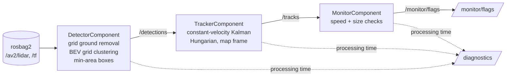

# lidar-tracking-ros2

Class-agnostic lidar object tracking in C++ / ROS 2: ground removal, clustering, box fitting, a Kalman + Hungarian tracker and a runtime monitor, run on Argoverse 2 sensor logs and scored with HOTA using the official `av2` tracking evaluation.

The algorithms are textbook on purpose. The work went into measuring them honestly: a frozen dev/test split, a scorer that is checked before any number is trusted, baselines and oracles next to every result, and a script that re-derives every number in this file.

**Headline (test split, 10 logs, 46,862 evaluated ground-truth boxes):** HOTA **0.304**, at 5.4 ms per frame mean on one CPU thread. No learned components.

## Pipeline



Three composable nodes in one container with intra-process communication (`launch/pipeline.launch.py`). The same core library also runs offline in `process_bag`, which reads a bag frame by frame and writes CSVs for scoring. See [Live pipeline](#live-pipeline) for how the live and offline outputs compare.

| Stage | What it does |
|---|---|
| Ground removal | 1 m BEV grid; ground height of a cell = lowest point in its 5x5 neighbourhood; keep points 0.25-3.0 m above it |
| Clustering | 0.15 m BEV cells; cells are linked when their squares are within 0.7 m, so two points closer than 0.7 m are never split |
| Boxes | minimum-area rectangle (convex hull + rotating calipers); drop clusters under 12 cells, thinner than 0.3 m, lower than 0.5 m, longer than 20 m or over 60 m² |
| Tracker | state [x y vx vy] in the map frame (ego pose from `/tf`), Hungarian assignment with a 2 m gate, a track is reported after 3 hits and deleted after 2 misses |
| Monitor | flags a track whose reported centre moves faster than 40 m/s, a small (< 1 m²) object faster than 12 m/s, or a BEV area that changes by more than 2x between reports |

## How it is scored

- **Data:** the first 20 logs (sorted by id) of the Argoverse 2 sensor validation split, lidar only. Dev = first 10, test = last 10. The split was frozen before any parameter was tuned; all tuning used dev; test was scored once, after the configuration was frozen (`configs/final.txt`).
- **Metric:** `av2` 0.3.6 tracking evaluation (TrackEval HOTA and CLEAR), BEV centre-distance similarity with a 2 m zero distance, 50 m range, drivable-area ROI.
- **Class-agnostic:** a clustering pipeline has no classes, so all 26 ground-truth categories are merged into one, and so are the predictions.
- **Invisible objects dropped:** ground-truth boxes with no lidar point inside are removed, as the official AV2 detection evaluation does.
- **No score tuning:** every output has score 1. The official `evaluate()` tunes a per-class score threshold on the data it reports on; there is nothing to tune here.

### Checking the scorer first

| Input fed to the scorer (all 20 logs) | HOTA | DetA | AssA |
|---|---|---|---|
| Ground truth with its real track ids | 1.000 | 1.000 | 1.000 |
| Ground truth with a new id in every frame | 0.116 | 1.000 | 0.013 |

The second row is the ceiling for any method that does not track: perfect detection alone stops near 0.12.

### Two issues in the av2 0.3.6 evaluation code

Both were found while checking the scorer and are worked around in `scripts/score.py`.

1. `filter_drivable_area` passes `translation_m - ego_translation_m` (a city-oriented offset) to `compute_objects_in_roi_mask`, which treats it as an ego-frame box and applies the full ego pose. Every box is rotated by the ego heading around the ego before the ROI lookup. On the 20 logs, the upstream filter keeps 58,651 ground-truth boxes; testing the box corners in the city frame keeps 90,718. `--upstream-roi` reproduces the upstream behaviour.
2. `evaluate()` copies `ego_translation_m` from labels to predictions with `annotate_frame_metadata`, which pairs frames by list position, after `filter_max_dist` has regrouped the labels in global timestamp order. With several logs, predictions receive another log's ego position and most are cut by the range filter. Here every frame carries its own ego pose, and `check_alignment()` asserts that labels and predictions agree.

## Results

### Test split

| Configuration | HOTA | DetA | AssA | DetPr | DetRe | ID switches |
|---|---|---|---|---|---|---|
| First detector (PCL KD-tree clustering, length and area limits only), no tracking | 0.041 | 0.146 | 0.012 | 0.159 | 0.608 | 29,669 |
| Final detector, no tracking | 0.045 | 0.184 | 0.011 | 0.270 | 0.347 | 17,006 |
| + nearest-neighbour association | 0.290 | 0.183 | 0.463 | 0.269 | 0.346 | 668 |
| + Kalman filter and Hungarian assignment | 0.298 | 0.184 | 0.488 | 0.270 | 0.346 | 616 |
| **+ report after 3 hits (final)** | **0.304** | 0.187 | 0.502 | 0.294 | 0.322 | 335 |
| Final, with the map's ground height instead of ours (oracle) | 0.325 | 0.193 | 0.554 | 0.302 | 0.332 | 257 |
| Ceiling without tracking (ground truth, new id each frame) | 0.112 | 1.000 | 0.013 | 1.000 | 1.000 | 46,269 |

The same final configuration scores 0.351 on dev, where it was tuned. Part of the drop to 0.304 on test is the cost of tuning on 10 logs and part may be harder logs; one split cannot separate the two.

What the table says:

- **Tracking is most of the score.** Without it, even perfect detection would stop at 0.112. Nearest-neighbour association alone takes the final detector from 0.045 to 0.290; the Kalman filter and track confirmation add another 0.014.
- **Ground removal is not the bottleneck.** Replacing it with the map's surveyed ground height gains 0.021. This oracle also drops the points the map raster does not cover (mostly far from the road), so it flatters the oracle a little.
- **Precision is.** Detection precision is 0.294 (HOTA's DetPr, averaged over the localisation thresholds). The false positives are static clutter near the road (poles, trunks, wall segments) that persists across frames, which track confirmation cannot remove.

### What it finds (test, recall at 1 m, no ROI filter)

| Ground-truth category | Boxes | Recall |
|---|---|---|
| REGULAR_VEHICLE | 24,785 | 51.6% |
| PEDESTRIAN | 9,143 | 21.4% |
| CONSTRUCTION_BARREL | 5,549 | 2.9% |
| BOLLARD | 3,540 | 2.1% |
| STOP_SIGN | 2,047 | 10.7% |
| BUS / BOX_TRUCK / LARGE_VEHICLE | 312 / 465 / 613 | 48.4% / 43.0% / 39.8% |
| All visible boxes within 50 m | 51,988 | 33.1% |

| Range | 0-10 m | 10-20 m | 20-30 m | 30-40 m | 40-50 m |
|---|---|---|---|---|---|
| Recall | 50.2% | 39.4% | 35.3% | 30.3% | 21.3% |

The size gates chosen on dev (at least 12 cells, 0.3 m wide, 0.5 m tall) remove most of the small static furniture (barrels, bollards, cones). That is the price of a single class-agnostic configuration.

### Clustering method (dev)

| Clustering (Kalman, 3 hits, length and area limits only) | HOTA | Mean / p95 / p99 per frame | Frames over 100 ms |
|---|---|---|---|
| PCL voxel grid + KD-tree Euclidean clustering | 0.256 | 79.0 / 108.1 / 111.7 ms | 10.0% |
| BEV grid connected components | 0.304 | 4.8 / 6.6 / 7.2 ms | 0.0% |

The grid version is 16x faster and scores higher. It never splits points closer than the tolerance and may merge points up to 0.42 m further apart, so walls tend to become one large cluster that the size limits reject instead of many small ones that pass.

### Runtime (test, final configuration)

Single thread, `process_bag`, bag I/O and message conversion excluded. Wall-clock timings vary by about 10% between repeated runs on the same machine.

| Stage | Mean |
|---|---|
| Ground removal | 1.15 ms |
| Clustering | 3.35 ms |
| Box fitting | 0.79 ms |
| Tracker | 0.10 ms |
| **Total per frame** | **5.4 ms mean, 8.9 ms p99, 25.3 ms max** (1,567 frames, 10 Hz budget 100 ms) |

### Runtime monitor: does it fire before tracking errors?

A tracking error is an *ID switch* (a track's matched ground-truth object changes) or a *lost object* (a track matched in its previous report is unmatched now). The thresholds are physical limits fixed in advance, not tuned. A shuffled-flag baseline (same flag rate, flags placed at random) gives the recall expected by chance.

| Test split (64,357 reports, 625 errors) | Errors with a flag | By chance | P(error \| flag) | P(error \| no flag) |
|---|---|---|---|---|
| Same report | 27.2% | 11.2% | 2.29% | 0.80% |
| Within the 5 reports (0.5 s) before | 52.6% | 45.9% | 6.42% | 4.22% |

- The size check marks the frames where errors happen at about 2.4x the chance rate, but as an early warning it is barely better than chance, and 98% of its flags are not followed by an error in the same report.
- The speed checks never fired on test. The tracker's 2 m association gate already makes such jumps in its own output impossible, so these checks only duplicate the gate.

### Live pipeline

On log `1f434d15` replayed with `ros2 bag play --delay 2` (the delay lets discovery finish before the first message), the three composed nodes published `/tracks` for 156 of the 156 frames, with the same track ids as `process_bag` in 156 of 156 frames and the same 930 monitor flags (930 offline). Without the delay the first and last frames were lost. Processing time over the last 50 frames, from `/diagnostics`:

| Node | Mean | p95 | Budget |
|---|---|---|---|
| lidar_detector | 4.48 ms | 4.90 ms | 80 ms |
| lidar_tracker | 0.26 ms | 0.37 ms | 10 ms |
| track_monitor | 0.12 ms | 0.20 ms | 5 ms |

Large point clouds (about 1.9 MB) need a reliable QoS: with best effort, about one cloud in 80 arrived, because losing any of a message's UDP fragments drops the whole message.

## Limitations

- 20 logs only; the dev/test gap shows how much the tuned gates depend on the logs they were tuned on.
- Class-agnostic scores are not comparable with the per-class AV2 tracking leaderboard, which is computed on the test split with learned detectors.
- No published class-agnostic clustering baseline exists on these logs, so the baselines here are internal (no tracking, nearest neighbour, oracles).
- The box centre of a partly visible vehicle is the centre of its visible points, which sits off the true centre; recall of nearby cars is only about one half.

## Reproduce

Ubuntu 26.04, ROS 2 Lyrical.

```bash
source env.sh
python3 scripts/fetch_av2.py --out data/av2 --n-logs 20             # 3.2 GB, lidar + labels + maps only
/usr/bin/python3 -m venv --system-site-packages .venv && .venv/bin/pip install -r requirements-bag.txt
.venv/bin/python -P scripts/av2_to_bag.py                             # 20 bags, 3.9 GB, read back and checked
# scoring env: see requirements-eval.txt (av2 0.3.6 needs Python <= 3.12)
colcon build && colcon test
scripts/run_all.sh test final_test $(grep -v '^#' configs/final.txt)
.venv-eval/bin/python -P scripts/monitor_eval.py --run runs/final_test
.venv-eval/bin/python -P scripts/category_recall.py --run runs/final_test
python3 -P scripts/make_results.py && python3 -P scripts/verify_readme_numbers.py
```

Live: `ros2 launch lidar_tracking pipeline.launch.py` and, in a second terminal, `ros2 bag play data/bags/<log>`.

## Data and licence

Code: MIT. Argoverse 2 data is licensed CC BY-NC-SA 4.0 and is not included or redistributed; `scripts/fetch_av2.py` downloads it from the public bucket.
